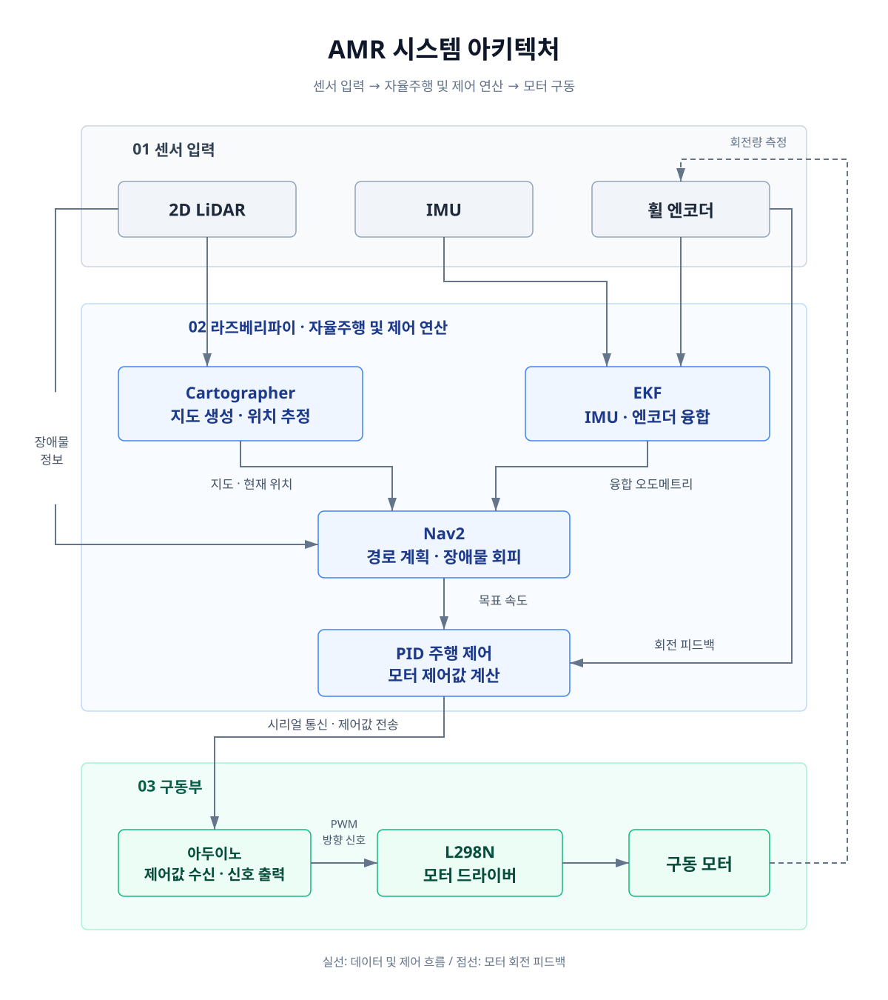

# 자동화 가습 AMR

**실내 여러 지점의 습도를 측정하고, 필요한 위치로 이동해 가습하는 자율이동로봇**입니다. 고정 경로의 AGV로는 경로 밖의 습도 차이를 놓칠 수 있어, 실내 지도를 만들고 목표 좌표로 이동할 수 있는 AMR로 전환했습니다.

- **개발 기간** 2023.03–2023.09
- **주요 기술** ROS 2 · Cartographer · Nav2 · `robot_localization` · SQLite
- **최종 도킹 시험** 10회 중 8회 성공

## 시스템 아키텍처

| 구성 | 역할 |
| --- | --- |
| 2D LiDAR · Cartographer | 실내 지도 생성과 위치 추정 |
| IMU · 휠 엔코더 · EKF | 두 센서 데이터를 융합해 주행에 필요한 오도메트리 추정 |
| 라즈베리파이 · Nav2 · PID | 경로 계획과 장애물 회피, 모터 제어값 연산 |
| 아두이노 · L298N | 시리얼로 받은 주행 제어값에 따라 아두이노가 제어 신호를 출력하고 L298N이 모터를 구동 |
| 습도 센서 · SQLite · 가습기 | 측정값을 위치와 함께 기록하고, 라즈베리파이의 시리얼 명령을 받은 아두이노가 가습기 제어 |

## 본인 기여

- 고정 경로 밖까지 습도 측정 범위를 넓히기 위해 AGV에서 AMR로 전환하는 방안을 제안했습니다.
- 주행 구간별로 IMU와 엔코더 기반 Yaw를 비교하고, `robot_localization`의 EKF를 적용해 두 센서 데이터를 융합했습니다.
- 하중과 가감속 특성을 고려해 주행 PID 파라미터를 조정하고 실제 도킹 동작을 반복 시험했습니다.

## 도킹 문제와 검증

도킹 위치에 도착한 뒤에도 가습기의 물 보충구와 스테이션 급수구가 어긋나면 물을 보충할 수 없었습니다. 위치 추정과 주행 제어 설정을 조정한 뒤, **물 보충이 가능한 정렬 상태**를 기준으로 도킹을 확인했습니다. 최종 시험에서 **10회 중 8회** 성공했습니다.

이 페이지는 당시 개발 과정과 검증 결과를 정리한 프로젝트 기록입니다.
